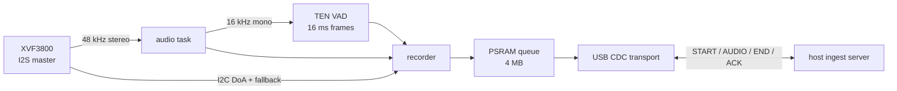

# Conversation Recorder — ESP32-S3 + XVF3800

Firmware for an XIAO ESP32-S3 Plus mounted on a Seeed reSpeaker XVF3800
four-microphone array. The device performs always-on capture, gates speech with
an on-device TEN VAD model, segments utterances, buffers unacknowledged audio
in PSRAM, and streams 16 kHz mono PCM over the native USB CDC port to a host
that owns STT and downstream knowledge-base processing.

There is no Wi-Fi, TCP, or discovery path. The only transport is USB.

## Architecture



Data path:

1. The XVF3800 provides a 48 kHz, 32-bit stereo I2S stream.
2. The audio task extracts channel 0, converts to 16-bit mono, and resamples
   the measured input rate to 16 kHz.
3. TEN VAD classifies 256-sample (16 ms) frames.
4. The recorder applies pre-roll, minimum-speech, holdback, and segment-cap
   rules, then queues `START`/`AUDIO`/`END` records.
5. The USB transport drains the queue over the native USB port and frees slots
   only after the host ACKs.
6. The host writes one WAV per segment and performs STT asynchronously.

## Repository layout

| Path | Purpose |
|---|---|
| `src/main.rs` | Peripheral setup, thread wiring, status loop |
| `src/audio.rs` | I2S capture, channel extraction, measured-rate resampling to 16 kHz |
| `src/recorder.rs` | Segmentation state machine and queue producer |
| `src/queue.rs` | Fixed-slot PSRAM ring with ACK-driven reclamation |
| `src/usb.rs` | USB CDC transport and ACK/resume logic |
| `src/xvf3800.rs` | I2C firmware probe, ASR routing, DoA polling |
| `src/ten_vad_model.rs` | Rust FFI wrapper for the on-device VAD |
| `src/ten_vad/` | Vendored TEN VAD C front end and model inference |
| `src/protocol.rs` | Wire record encoding/decoding and ACK parser |
| `src/config.rs` | Build-time configuration |
| `audio-receiver/receiver.py` | USB serial receiver, WAV writer, and ACKs |
| `audio-receiver/test_receiver.py` | USB serial integration tests |
| `audio-receiver/README.md` | Host receiver usage |
| `tools/export_ten_vad_weights.py` | Regenerates the C weight header from ONNX |

## Prerequisites

- ESP32-S3 Rust toolchain (`espup`, `esp` toolchain).
- ESP-IDF v5.4, activated in the environment.
- `ldproxy` for linking.
- `espflash` on the host for flashing.
- Python 3.10+ for the reference receiver.

The repository builds only; flashing is performed from the host because the
development container does not pass through USB.

## Build

Fresh container, first time:

```sh
# If the image does not already provide the Xtensa Rust toolchain:
cargo install espup --locked
espup install --targets esp32s3
. "$HOME/export-esp.sh"

# Install the linker proxy with the host toolchain, not the esp toolchain:
cargo +stable install ldproxy --locked

cargo build --release
```

Subsequent builds only need:

```sh
cargo build --release
```

Artifact:

```text
target/xtensa-esp32s3-espidf/release/conversation-recorder
```

The first build compiles ESP-IDF through `esp-idf-sys` and takes several
minutes. Use `cargo build -vv` for progress.

The devcontainer uses `espressif/idf-rust:all_latest`. `.cargo/config.toml`
sets `ESP_IDF_TOOLS_INSTALL_DIR = "fromenv"` because the image activates an
ESP-IDF environment, and pins `ESP_IDF_VERSION = "v5.4"`.

If `cargo +stable` is unavailable, install the host toolchain first:

```sh
rustup toolchain install stable
```

If ESP-IDF's CMake rejects the Xtensa GCC version, the compiler installed by
`espup` is shadowing the container's IDF toolchain. Put the IDF compiler first
on `PATH`:

```sh
export PATH="/opt/esp/tools/xtensa-esp-elf/esp-14.2.0_20260121/xtensa-esp-elf/bin:$PATH"
```

## Configuration

All build-time settings live in `src/config.rs`.

| Setting | Default | Notes |
|---|---|---|
| `I2S_RATE` | `48_000` | 48 kHz master image |
| `I2S_SLAVE` | `true` | XVF3800 drives BCLK/WS |
| `I2S_BITS` | `16` | Slot width: 16 for v1.0.5 master, 32 for v1.0.9 |
| `I2S_CHANNEL` | `0` | Routed ASR lane; use `1` for the default right ASR lane |
| `TEN_VAD_THRESHOLD` | `0.35` | Start threshold; higher rejects more non-speech |
| `TEN_VAD_CONTINUE_THRESHOLD` | `0.20` | Keepalive threshold once a segment is active |
| `REQUIRE_XVF_SPEECH` | `false` | Require XVF speech agreement to start when the XVF is healthy; leave off for v1.0.5 |
| `USE_TEN_VAD` | `false` | Use XVF3800 speech flag/DoA; enable for TEN VAD |
| `MIN_SPEECH_MS` | `600` | Speech required in the rolling 2 s window |
| `PRE_ROLL_MS` | `3_000` | Audio retained before trigger |
| `LOG_ONLY` | `false` | Set `true` for log-only simulation; `false` sends audio |
| `HOLDBACK_MS` | `1_500` | Trailing audio queued after speech |
| `SILENCE_TIMEOUT_MS` | `60_000` | Conversation ends after this much silence |
| `SEGMENT_MS` | `1_800_000` | Hard cap for continuous speech |
| `ONE_SHOT` | `false` | One-shot test mode; false uses VAD segmentation |
| `ONE_SHOT_MS` | `60_000` | One-shot capture duration |
| `QUEUE_BYTES` | `4 MB` | Unacknowledged audio buffer |

## Flash

Stop the serial receiver before flashing; it holds the USB tty open.

The VADNet build uses a custom partition table and a model partition.
`espflash flash` writes its own default partition table at `0x8000`, so
write the custom table **last**:

```sh
espflash flash --monitor --chip esp32s3 \
  target/xtensa-esp32s3-espidf/release/conversation-recorder
espflash write-bin 0x400000 firmware-assets/srmodels.bin --chip esp32s3
espflash write-bin 0x8000 firmware-assets/partition-table.bin --chip esp32s3
```

The table must define `factory` at `0x10000` (4 MB) and `model` at
`0x400000` (3 MB).

Expected boot and runtime logs:

```text
XVF3800 firmware v1.0.9
I2S configured 48000 Hz, observed 4799x Hz
XVF3800 DOA_VALUE read via cmd 18
vadnet: VADNet vadnet1_medium ready: chunk=... rate=16000
usb: host attached
```

Under WSL2, attach the USB device before starting the receiver:

```sh
usbipd attach --wsl --busid <id>
```

It then appears as `/dev/ttyACM0` or similar.

## XVF3800 requirements

The array must run an **I2S** firmware image, not the USB image.

| Configuration | Image | Firmware settings |
|---|---|---|
| 48 kHz master, XIAO slave | `respeaker_44mm_i2s_c48k2ch_v1.0.0.bin` or `respeaker_xvf3800_i2s_master_v1.0.9_48k.bin` | `I2S_RATE = 48_000`, `I2S_SLAVE = true`, `I2S_BITS = 32` |
| 48 kHz master (old v1.0.5 DFU image) | `respeaker_xvf3800_i2s_master_dfu_firmware_v1.0.5_48k.bin` | `I2S_RATE = 48_000`, `I2S_SLAVE = true`, `I2S_BITS = 16` |
| 16 kHz slave | `respeaker_xvf3800_i2s_slave_v1.0.9_16k.bin` | `I2S_RATE = 16_000`, `I2S_SLAVE = false`, `I2S_BITS = 32` |

XVF parameters are volatile across reset. The firmware reapplies
`AEC_ASROUTONOFF=1` and `AUDIO_MGR_OP_L=[7,3]` on every boot. If the routing
writes are rejected, set `I2S_CHANNEL = 1` to use the firmware's default
right-channel ASR output.

`DOA_VALUE` moved from command 19 to 18 in I2S firmware v1.0.8. The firmware
reads the version and selects the matching command, falling back to a probe if
the version read fails. Firmware older than v1.0.6 has no `DOA_VALUE` command;
TEN VAD still drives segmentation.

### Pinout

| Signal | XIAO pin |
|---|---|
| I2S BCLK | GPIO8 |
| I2S WS | GPIO7 |
| I2S DIN (XVF → ESP) | GPIO43 |
| I2C SDA | GPIO5 |
| I2C SCL | GPIO6 |
| Status LED | GPIO21, active low |
| USB D− | GPIO19 |
| USB D+ | GPIO20 |

XVF3800 I2C address: `0x2C`.

## Runtime behavior

### Speech detection

- TEN VAD runs on 256-sample, 16 ms frames at 16 kHz. Its 302 KB of weights
  are placed in PSRAM (`CONFIG_SPIRAM_RODATA`) and the CPU runs at 240 MHz;
  with the weights in 40 MHz DIO flash it needed ~39 ms per 20 ms block.
- A segment is committed after 600 ms of speech in a rolling 2 s window. Short
  gaps do not reset the window, so normal speech with plosives and pauses still
  triggers while a clap does not. The 3 s pre-roll is the candidate buffer: it
  captures audio before the commit point, so the first word is not lost.
- Before sending, the candidate pre-roll is checked for active duration and
  envelope peaks. A clap/short transient is rejected on-device and never
  queued; the LED stays in its idle pattern.
- When the XVF3800 is healthy and `REQUIRE_XVF_SPEECH` is set, its speech flag
  must agree with TEN VAD before a segment starts. If the XVF is unavailable,
  TEN VAD decides alone.
- The task measures the actual I2S rate over the first two seconds and
  resamples that rate to 16 kHz. A nominal 48 kHz stream is still resampled
  with the same fractional phase accumulator.
- If TEN VAD initialization fails, the recorder falls back to the XVF3800
  `DOA_VALUE` speech flag on firmware v1.0.6+, then to `AEC_SPENERGY_VALUES`,
  then to an ESP energy VAD.
- Set `USE_TEN_VAD = false` to bypass the model and use the XVF speech energy.

### Segmentation

| Event | Behavior |
|---|---|
| 600 ms speech in a 2 s window | Commit segment; flush 3 s pre-roll |
| Speech stops | Queue 1.5 s holdback |
| 60 s of silence | End segment (`reason 0`) |
| Pause < 60 s | Same segment |
| Pause > 60 s | Next speech starts a new segment |
| 30 min cap | Rotate to a new segment without stopping capture (`reason 2`) |
| Queue overflow | End segment (`reason 1`) |

Continuous speech rotates at 30 min by queueing `END` for the finished segment
and `START` for the next one. No audio is duplicated or dropped at the
boundary. The first segment's cap includes the pre-roll window.

### Queue and backpressure

- 4 MB PSRAM ring of fixed slots: `START`, `AUDIO` (≤1600 samples / 100 ms),
  and `END`.
- Audio is produced at 32 KB/s (16 kHz × 2 bytes).
- The USB transport sends continuously; slots are freed only after ACK.
- A missing host accumulates approximately 128 s of audio. At full capacity
  the current segment ends with `reason 1`; new segments cannot start until
  ACKs free space.
- The queue is volatile. Power loss discards unacknowledged audio. There is no
  SD card or flash spool.

### LED

| Condition | Pattern |
|---|---|
| Audio not ready or USB host detached | 100 ms on / 200 ms period |
| Backlog > 256 KB | 500 ms on / 1000 ms period |
| Recording | Solid on |
| Idle | 20 ms on / 2000 ms period |

The LED follows the open/closed segment, not instantaneous speech. It stays
solid through the 60 s silence wait and turns off when `END` is queued.

The LED turns on only after the recorder has confirmed a segment start, i.e.
after `MIN_SPEECH_MS` of speech that passed the start gate. A short clap or
noise burst does not light it.

## USB transport

The device enumerates as a USB CDC serial device and streams the same records
used by the previous TCP path. On the host:

```sh
python3 audio-receiver/receiver.py --serial /dev/ttyACM0 --out recordings
```

On Windows, install pyserial and use the COM port:

```powershell
python -m pip install -r audio-receiver\requirements.txt
python audio-receiver\receiver.py --serial COM3 --out recordings
```

Behavior:

- Opens the port raw on POSIX or via pyserial on Windows; no echo or flow
  control.
- Writes one 16 kHz mono s16le WAV per segment.
- Sends ACKs back over the same tty after each `AUDIO` record and after `END`.
- The ESP-IDF console shares the port. The receiver resyncs past log text by
  scanning for the record magic.
- Each record is written in one short write into an 8 KB TX ring, so a console
  line cannot split an audio record.
- If the cable drops, the device rewinds to the last ACK. The receiver reopens
  the tty and the device resends `START` with that offset; the partial WAV is
  truncated and continued.
- Stop the receiver before `espflash flash`.

## Wire protocol

All fields little-endian. Record header, 12 bytes:

```text
u32 magic = 0x43455243 ("CREC")
u8  version = 1
u8  type
u16 flags
u32 payload length
```

| Type | Value | Payload |
|---|---|---|
| `START` | `1` | `u32 session_id`, `u32 first_sample`, `u32 sample_rate`, `u16 channels`, `u16 bits`, `u64 start_unix_ms`, `u64 device_uptime_ms`, `u8 device_id[16]` |
| `AUDIO` | `2` | Raw s16le PCM |
| `END` | `3` | `u32 session_id`, `u32 total_samples`, `u8 reason`, `u8 reserved[3]`, `u32 crc32` |
| `ACK` | `0x81` | `u32 session_id`, `u32 acked_samples` |

`END.reason`: `0` silence timeout, `1` queue overflow, `2` segment cap.
`END.crc32` is currently `0` (not provided).
ACK header flag bit 0 marks the final ACK sent after `END`.

## Reliability and failure modes

| Failure | Behavior |
|---|---|
| USB host absent | No records leave the device; PSRAM fills; LED slow-blinks |
| USB cable drop | Device rewinds to last ACK; receiver reopens the tty and resumes |
| Device power loss | Unacknowledged PSRAM audio is lost |
| Receiver stops | Device keeps queueing; reconnect resumes from last ACK |
| Queue overflow | Current segment ends with `reason 1` |
| XVF I2S firmware absent | No usable I2S clock/data; rate check logs failure |
| TEN VAD init failure | Falls back to XVF speech flag, then energy VAD |

## Security

- The transport is physical USB. Access to the host or cable grants access to
  the microphone stream.
- WAV files on the host are plaintext; apply host disk encryption and access
  controls as required.
- There is no network authentication or encryption layer because there is no
  network transport.

## Testing

Build:

```sh
cargo build --release
```

USB ingest tests:

```sh
python3 audio-receiver/test_receiver.py -v
```

The tests use a PTY to cover START/AUDIO/END ingestion, WAV correctness,
console-text resync, and resume after a link drop.

TEN VAD port validation: the C implementation was compared against the
upstream TEN VAD library on a 720-frame speech file. Maximum absolute
probability difference was `7e-4`, mean `7e-5`.

## On-device VAD model

The firmware vendors an ONNX-Runtime-free port of
[TEN VAD](https://github.com/TEN-framework/ten-vad):

- 309 KB ONNX model; 302 KB float32 weights in flash.
- 3 × 41 mel/pitch context, separable convolution front end, two 64-unit
  LSTMs, and a 128→32→1 dense head.
- 16 kHz, 256-sample hop, probability output.
- Upstream C front end retained: STFT, mel filterbank, pitch, scoring.
- ONNX Runtime replaced by `src/ten_vad/aivad_model.c`.
- Weights regenerated with `python3 tools/export_ten_vad_weights.py`.

TEN VAD is a speech/non-speech classifier. It rejects most steady noise,
cat/dog sounds, and instrumental music, but it is not a human-voice or source
classifier. TV, podcasts, other people, and songs with vocals are human speech
and will pass. This is intentional for this recorder. Tune
`TEN_VAD_THRESHOLD` against representative recordings.

## Known limitations

- No persistent local storage; unacknowledged audio lives only in PSRAM.
- USB only; no Wi-Fi, TCP, or discovery.
- WAV files on the host are plaintext.
- TEN VAD only meets the 16 ms budget with its weights in PSRAM and the CPU
  at 240 MHz. Verify the `TEN VAD: ... us per 20 ms block` log on your build.
- The XVF3800 must run a matching I2S firmware image.
- The receiver holds the tty open; stop it before flashing.

## Licensing

The vendored TEN VAD sources are Copyright © 2025 Agora and are licensed under
the Apache License 2.0 with additional conditions. See
`src/ten_vad/LICENSE` and `src/ten_vad/NOTICES`. Review those terms before
commercial deployment.
