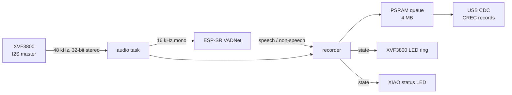

# Conversation Recorder Firmware

Firmware for an XIAO ESP32-S3 Plus mounted on a Seeed reSpeaker XVF3800
four-microphone array. The device performs always-on capture, gates speech with
ESP-SR VADNet on the ESP32-S3, segments utterances, buffers unacknowledged
audio in PSRAM, and streams framed 16 kHz mono PCM over the native USB CDC
port.

Speech detection, segmentation, and buffering run entirely on the device. The
only transport is USB; there is no Wi-Fi, TCP, or discovery path.

## Architecture



Data path:

1. The XVF3800 provides a 48 kHz, 32-bit stereo I2S stream.
2. The audio task extracts the ASR-routed channel, converts to 16-bit mono,
   filters, and resamples the measured input rate to 16 kHz.
3. ESP-SR VADNet classifies the 16 kHz mono stream.
4. The recorder applies pre-roll, speech-duration, holdback, and segment-cap
   rules, then queues `START`/`AUDIO`/`END` records.
5. The USB transport drains the queue over the native USB port. Slots are
   released only after the USB side acknowledges them.

## Repository layout

| Path | Purpose |
|---|---|
| `src/main.rs` | Peripheral setup, thread wiring, status loop |
| `src/audio.rs` | I2S capture, channel extraction, measured-rate resampling to 16 kHz |
| `src/recorder.rs` | Segmentation state machine, pre-roll, queue producer |
| `src/queue.rs` | Fixed-slot PSRAM ring with acknowledgement-driven reclamation |
| `src/usb.rs` | USB CDC transport, ACK handling, resume |
| `src/protocol.rs` | Record encoding/decoding and ACK parser |
| `src/xvf3800.rs` | I2C firmware probe, ASR routing, LED ring |
| `src/vadnet.rs` | Rust wrapper for the ESP-SR VADNet bridge |
| `src/config.rs` | Build-time configuration |
| `components/vadnet_bridge/` | ESP-SR VADNet bridge |
| `components_esp32s3.lock` | Resolved ESP-IDF component versions |
| `firmware-assets/` | VADNet model blob and partition table for flashing |
| `partitions.csv` | Custom partition table |
| `sdkconfig.defaults` | ESP-IDF defaults |
| `build.rs` | ESP-IDF build environment integration |

## Prerequisites

- ESP32-S3 Rust toolchain (`espup`, `esp` toolchain).
- ESP-IDF v5.4, activated in the environment.
- `ldproxy` for linking.
- `espflash` for flashing.
- Python 3.10+ if running ESP-IDF tooling that requires it.

The development container builds only; flashing is performed from a machine
with access to the device's USB port.

## Build

Fresh container, first time:

```sh
# If the image does not already provide the Xtensa Rust toolchain:
cargo install espup --locked
espup install --targets esp32s3
. "$HOME/export-esp.sh"

# Install the linker proxy with the host toolchain, not the esp toolchain:
cargo +stable install ldproxy --locked

cargo build --release
```

Subsequent builds only need:

```sh
cargo build --release
```

Artifact:

```text
target/xtensa-esp32s3-espidf/release/conversation-recorder
```

The first build compiles ESP-IDF and ESP-SR through `esp-idf-sys` and takes
several minutes. Use `cargo build -vv` for progress.

The devcontainer uses `espressif/idf-rust:all_latest`. `.cargo/config.toml`
sets `ESP_IDF_TOOLS_INSTALL_DIR = "fromenv"` because the image activates an
ESP-IDF environment, and pins `ESP_IDF_VERSION = "v5.4"`.

If `cargo +stable` is unavailable, install the host toolchain first:

```sh
rustup toolchain install stable
```

If ESP-IDF's CMake rejects the Xtensa GCC version, the compiler installed by
`espup` is shadowing the container's IDF toolchain. Put the IDF compiler first
on `PATH`:

```sh
export PATH="/opt/esp/tools/xtensa-esp-elf/esp-14.2.0_20260121/xtensa-esp-elf/bin:$PATH"
```

## Configuration

All build-time settings live in `src/config.rs`.

| Setting | Default | Notes |
|---|---|---|
| `I2S_RATE` | `48_000` | 48 kHz master image |
| `I2S_SLAVE` | `true` | XVF3800 drives BCLK/WS |
| `I2S_BITS` | `32` | Slot width: 16 for v1.0.5 master, 32 for v1.0.9 |
| `I2S_CHANNEL` | `0` | Routed ASR lane; use `1` for the default right ASR lane |
| `MIN_SPEECH_MS` | `600` | Speech required in the rolling 2 s window |
| `PRE_ROLL_MS` | `3_000` | Audio retained before trigger |
| `HOLDBACK_MS` | `1_500` | Trailing audio queued after speech |
| `SPEECH_RESUME_MS` | `300` | Speech required to reset the silence timer |
| `SPEECH_ZCR_MIN` | `0.05` | Minimum smoothed ZCR for VADNet speech |
| `SPEECH_ZCR_WINDOW_MS` | `200` | ZCR smoothing window |
| `SILENCE_TIMEOUT_MS` | `2_000` | Segment ends after this much silence |
| `SEGMENT_MS` | `1_800_000` | Hard cap for continuous speech |
| `RING_SPEECH_HOLD_MS` | `400` | Keep the blue DoA ring this long after speech stops |
| `QUEUE_BYTES` | `4 MB` | Unacknowledged audio buffer |
| `ONE_SHOT` | `false` | One-shot capture mode; disables VAD segmentation |
| `ONE_SHOT_MS` | `60_000` | One-shot capture duration |
| `LOG_ONLY` | `false` | Log candidates but do not queue or send audio |

## Flash

Disconnect any serial monitor that holds the USB CDC port.

The VADNet build uses a custom partition table and a model partition.
`espflash flash` writes its own default partition table at `0x8000`, so write
the custom table **last**:

```sh
espflash flash --monitor --chip esp32s3 \
  target/xtensa-esp32s3-espidf/release/conversation-recorder
espflash write-bin 0x400000 firmware-assets/srmodels.bin --chip esp32s3
espflash write-bin 0x8000 firmware-assets/partition-table.bin --chip esp32s3
```

The table defines `factory` at `0x10000` (4 MB) and `model` at `0x400000`
(3 MB). `firmware-assets/` ships the matching `srmodels.bin`
(`CONFIG_SR_VADN_VADNET1_MEDIUM=y`) and partition table.

Expected boot and runtime logs:

```text
XVF3800 firmware v1.0.9
I2S configured 48000 Hz, observed 4799x Hz
vadnet: VADNet vadnet1_medium ready: chunk=... rate=16000 threshold=0.500 energy=-45.0 dBFS
usb: host attached
```

## XVF3800 requirements

The array must run an **I2S** firmware image, not the USB image.

| Configuration | Image | Firmware settings |
|---|---|---|
| 48 kHz master, XIAO slave | `respeaker_44mm_i2s_c48k2ch_v1.0.0.bin` or `respeaker_xvf3800_i2s_master_v1.0.9_48k.bin` | `I2S_RATE = 48_000`, `I2S_SLAVE = true`, `I2S_BITS = 32` |
| 48 kHz master (old v1.0.5 DFU image) | `respeaker_xvf3800_i2s_master_dfu_firmware_v1.0.5_48k.bin` | `I2S_RATE = 48_000`, `I2S_SLAVE = true`, `I2S_BITS = 16` |
| 16 kHz slave | `respeaker_xvf3800_i2s_slave_v1.0.9_16k.bin` | `I2S_RATE = 16_000`, `I2S_SLAVE = false`, `I2S_BITS = 32` |

XVF parameters are volatile across reset. The firmware reapplies
`AEC_ASROUTONOFF=1` and `AUDIO_MGR_OP_L=[7,3]` on every boot. If the routing
writes are rejected, set `I2S_CHANNEL = 1` to use the firmware's default
right-channel ASR output.

The firmware version is logged at boot. Speech detection does not depend on
XVF firmware features; VADNet runs entirely on the ESP32-S3.

### Pinout

| Signal | XIAO pin |
|---|---|
| I2S BCLK | GPIO8 |
| I2S WS | GPIO7 |
| I2S DIN (XVF → ESP) | GPIO43 |
| I2C SDA | GPIO5 |
| I2C SCL | GPIO6 |
| Status LED | GPIO21, active low |
| USB D− | GPIO19 |
| USB D+ | GPIO20 |

XVF3800 I2C address: `0x2C`.

## Runtime behavior

### Capture

- The XVF3800 supplies 48 kHz, 32-bit stereo I2S as master.
- The audio task extracts the configured channel, converts to 16-bit mono,
  applies a sixth-order low-pass at 7.2 kHz, and resamples to 16 kHz.
- The actual input rate is measured over the first two seconds. A nominal
  48 kHz stream is still resampled through the same fractional phase
  accumulator.

### Speech detection

- ESP-SR VADNet (`vadnet1_medium`) runs on the ESP32-S3 and classifies the
  16 kHz mono stream. Its model is loaded from the `model` flash partition.
- VADNet is the only speech model. If it fails to initialize, the audio task
  exits with an error instead of falling back to XVF or energy heuristics.
- VADNet runs in mode 2 with a 250 ms minimum speech duration, a 0.5 detection
  threshold, and a -45 dBFS energy threshold.
- A low-frequency guard follows VADNet. It computes a 200 ms smoothed
  zero-crossing rate and rejects VADNet speech below `0.05`. This drops
  low-frequency rumble without imposing an amplitude floor, so quiet speech
  with normal speech ZCR still passes.
- A segment is committed after 600 ms of VADNet speech in a rolling 2 s window.
  Short gaps do not reset the window, so normal speech with plosives and pauses
  still triggers.
- The 3 s pre-roll is the candidate buffer: it captures audio before the
  commit point, so the first word is not lost.
- Before queuing, the candidate is checked for active duration and envelope
  peaks. A clap or short transient is rejected on-device and never sent.
- VADNet distinguishes speech from noise. It does not identify speakers and
  does not reject music, TV, or other non-target voices that it classifies as
  speech.

### Segmentation

| Event | Behavior |
|---|---|
| 600 ms speech in a 2 s window | Commit segment; flush 3 s pre-roll |
| Speech stops | Queue 1.5 s holdback |
| 2 s of silence | End segment (`reason 0`) |
| Pause < 2 s | Same segment |
| Pause > 2 s | Next speech starts a new segment |
| 30 min cap | Rotate to a new segment without stopping capture (`reason 2`) |
| Queue overflow | End segment (`reason 1`) |

Continuous speech rotates at 30 min by queueing `END` for the finished segment
and `START` for the next one. No audio is duplicated or dropped at the
boundary. The first segment's cap includes the pre-roll window.

### Queue and backpressure

- 4 MB PSRAM ring of fixed slots: `START`, `AUDIO` (≤1600 samples / 100 ms),
  and `END`.
- Audio is produced at 32 KB/s (16 kHz × 2 bytes).
- The USB transport sends continuously; slots are freed only after an ACK.
- An unresponsive USB reader accumulates approximately 128 s of audio. At full
  capacity the current segment ends with `reason 1`; new segments cannot start
  until ACKs free space.
- The queue is volatile. Power loss discards unacknowledged audio. There is no
  SD card or flash spool.

### LED

The XIAO status LED uses GPIO21, active low.

| Condition | Pattern |
|---|---|
| Audio not ready or USB detached | 100 ms on / 200 ms period |
| Backlog > 256 KB | 500 ms on / 1000 ms period |
| Recording | Solid on |
| Idle | 20 ms on / 2000 ms period |

The XIAO LED follows the open/closed segment, not instantaneous speech. It
stays solid through the 2 s silence wait and turns off when `END` is queued.

The XVF3800 LED ring reflects the recorder's session state:

| Ring | Meaning |
|---|---|
| Off | No session open, or silence hold |
| Blue DoA segment | Session committed; speech is being recorded |

While VADNet reports speech, the ring runs the XVF DoA effect with a black base
color and a blue direction color. Only the LEDs for the current sound direction
light. This is the XVF's internal DoA rendering; the ESP32 does not read the
angle. After `RING_SPEECH_HOLD_MS` (400 ms) without speech, the ring turns off
and stays off through the 2 s silence timeout until `END`. The XIAO LED remains
on during that hold. Rejected candidates do not light the ring.

The ring reaches blue about 0.6–0.7 s after speech onset: the commit needs
`MIN_SPEECH_MS` (600 ms), plus an audio block and the XVF task's 50 ms poll.
Utterances shorter than that window never open a segment.

## USB output

The device enumerates as a USB CDC serial device. The ESP-IDF console shares
the port, so records are framed with a magic value and a reader must resync
past log text.

- `START` carries session identity, sample format, and starting offset.
- `AUDIO` carries raw s16le PCM.
- `END` closes the segment with a reason code.
- The reader ACKs received sample counts; the device frees queued slots only
  after the ACK.
- Each record is written in one short write into an 8 KB TX ring, so a console
  line cannot split an audio record.
- If the link drops, the device rewinds to the last ACK. On reconnect it resends
  `START` with that sample offset and continues from there.

## Wire protocol

All fields little-endian. Record header, 12 bytes:

```text
u32 magic = 0x43455243 ("CREC")
u8  version = 1
u8  type
u16 flags
u32 payload length
```

| Type | Value | Payload |
|---|---|---|
| `START` | `1` | `u32 session_id`, `u32 first_sample`, `u32 sample_rate`, `u16 channels`, `u16 bits`, `u64 start_unix_ms`, `u64 device_uptime_ms`, `u8 device_id[16]` |
| `AUDIO` | `2` | Raw s16le PCM |
| `END` | `3` | `u32 session_id`, `u32 total_samples`, `u8 reason`, `u8 reserved[3]`, `u32 crc32` |
| `ACK` | `0x81` | `u32 session_id`, `u32 acked_samples` |

`END.reason`: `0` silence timeout, `1` queue overflow, `2` segment cap.
`END.crc32` is currently `0` (not provided). ACK header flag bit 0 marks the
final ACK sent after `END`.

## Failure modes

| Failure | Behavior |
|---|---|
| USB detached | No records leave the device; PSRAM fills; LED slow-blinks |
| USB link drop | Device rewinds to the last ACK and resumes from that offset |
| Device power loss | Unacknowledged PSRAM audio is lost |
| USB reader stalls | Device keeps queueing; reconnect resumes from the last ACK |
| Queue overflow | Current segment ends with `reason 1` |
| XVF I2S firmware absent | No usable I2S clock/data; rate check logs failure |
| VADNet model missing | VADNet init fails; audio task exits with an error |
| XVF I2C unreachable | ASR routing and LED ring retry; capture continues if I2S is up |

## Transport security

USB is the only transport; there is no network stack, authentication, or
encryption layer. Physical access to the USB port grants access to the
microphone stream.

## On-device VAD

VADNet comes from Espressif's ESP-SR component (`espressif/esp-sr` 2.6.2,
`CONFIG_SR_VADN_VADNET1_MEDIUM`). `components/vadnet_bridge/` wraps the ESP-SR
VAD interface, buffers 16 kHz mono audio into the model's expected chunk size,
and returns a speech/non-speech verdict per chunk.

VADNet is a speech/non-speech classifier. It rejects most steady noise, cat/dog
sounds, and instrumental music, but it is not a human-voice or source
classifier. TV, podcasts, other people, and songs with vocals pass as speech.
The bridge logs every `VAD speech` / `VAD silence` transition, and the recorder
logs when the ZCR guard rejects an otherwise speech-labelled low-frequency
event.

## Known limitations

- No persistent local storage; unacknowledged audio lives only in PSRAM.
- USB only; no Wi-Fi, TCP, or discovery.
- The `model` partition and `srmodels.bin` must match the firmware; a missing
  model stops the audio task at boot.
- The XVF3800 must run a matching I2S firmware image.
- A serial monitor or other process holding the USB CDC port must be closed
  before flashing.
