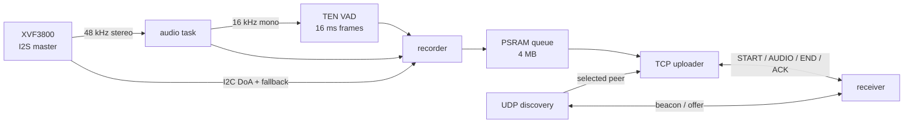

# Conversation Recorder — ESP32-S3 + XVF3800

Firmware for an XIAO ESP32-S3 Plus mounted on a Seeed reSpeaker XVF3800
four-microphone array. The device performs always-on capture, gates speech with
an on-device TEN VAD model, segments utterances, buffers unacknowledged audio
in PSRAM, and streams 16 kHz mono PCM over TCP to a receiver that owns STT and
downstream knowledge-base processing.

The receiver is discovered automatically over UDP; no static receiver address
is required.

## Architecture



Data path:

1. The XVF3800 provides a 48 kHz, 32-bit stereo I2S stream.
2. The audio task extracts channel 0, converts to 16-bit mono, and decimates
   48 kHz to 16 kHz.
3. TEN VAD classifies 256-sample (16 ms) frames.
4. The recorder applies pre-roll, minimum-speech, holdback, and segment-cap
   rules, then queues `START`/`AUDIO`/`END` records.
5. The uploader drains the queue over TCP and frees slots only after receiver
   ACKs.
6. The receiver writes one WAV per segment and performs STT asynchronously.

## Repository layout

| Path | Purpose |
|---|---|
| `src/main.rs` | Peripheral setup, thread wiring, status loop |
| `src/audio.rs` | I2S capture, channel extraction, 48→16 kHz decimation |
| `src/recorder.rs` | Segmentation state machine and queue producer |
| `src/queue.rs` | Fixed-slot PSRAM ring with ACK-driven reclamation |
| `src/uploader.rs` | TCP transport and ACK/resume logic |
| `src/discovery.rs` | UDP beacon and receiver offer handling |
| `src/xvf3800.rs` | I2C firmware probe, ASR routing, DoA polling |
| `src/ten_vad_model.rs` | Rust FFI wrapper for the on-device VAD |
| `src/ten_vad/` | Vendored TEN VAD C front end and model inference |
| `src/protocol.rs` | Wire record encoding/decoding |
| `src/config.rs` | Build-time configuration |
| `tools/ingest_server.py` | Reference receiver: discovery, TCP server, WAV writer |
| `tools/test_ingest_server.py` | Receiver and discovery integration tests |
| `tools/export_ten_vad_weights.py` | Regenerates the C weight header from ONNX |

## Prerequisites

- ESP32-S3 Rust toolchain (`espup`, `esp` toolchain).
- ESP-IDF v5.4, activated in the environment.
- `ldproxy` for linking.
- `espflash` on the host for flashing.
- Python 3.10+ for the reference receiver.

The repository builds only; flashing is performed from the host because the
development container does not pass through USB.

## Build

Fresh container, first time:

```sh
# If the image does not already provide the Xtensa Rust toolchain:
cargo install espup --locked
espup install --targets esp32s3
. "$HOME/export-esp.sh"

# Install the linker proxy with the host toolchain, not the esp toolchain:
cargo +stable install ldproxy --locked

cargo build --release
```

Subsequent builds only need:

```sh
cargo build --release
```

Artifact:

```text
target/xtensa-esp32s3-espidf/release/conversation-recorder
```

The first build compiles ESP-IDF through `esp-idf-sys` and takes several
minutes. Use `cargo build -vv` for progress.

The devcontainer uses `espressif/idf-rust:all_latest`. `.cargo/config.toml`
sets `ESP_IDF_TOOLS_INSTALL_DIR = "fromenv"` because the image activates an
ESP-IDF environment, and pins `ESP_IDF_VERSION = "v5.4"`.

If `cargo +stable` is unavailable, install the host toolchain first:

```sh
rustup toolchain install stable
```

If ESP-IDF's CMake rejects the Xtensa GCC version, the compiler installed by
`espup` is shadowing the container's IDF toolchain. Put the IDF compiler first
on `PATH`:

```sh
export PATH="/opt/esp/tools/xtensa-esp-elf/esp-14.2.0_20260121/xtensa-esp-elf/bin:$PATH"
```

## Configuration

All build-time settings live in `src/config.rs`.

| Setting | Default | Notes |
|---|---|---|
| `WIFI_SSID`, `WIFI_PASSWORD` | empty | 2.4 GHz only |
| `PEER_HOST` | empty | Empty enables discovery. Set for a static receiver fallback. |
| `PEER_PORT` | `8000` | Static receiver port |
| `PAIRING_TOKEN` | empty | Required for discovery. Must match `--token` on the receiver. Empty disables discovery; static `PEER_HOST` still works. |
| `DISCOVERY_PORT` | `8001` | UDP beacon/offer port |
| `I2S_RATE` | `48_000` | 48 kHz master image |
| `I2S_SLAVE` | `true` | XVF3800 drives BCLK/WS |
| `I2S_CHANNEL` | `0` | Routed ASR lane; use `1` for the default right ASR lane |
| `TEN_VAD_THRESHOLD` | `0.65` | Higher rejects more non-speech |
| `MIN_SPEECH_MS` | `250` | Trigger duration |
| `PRE_ROLL_MS` | `1_500` | Audio retained before trigger |
| `HOLDBACK_MS` | `1_500` | Trailing audio queued after speech |
| `SILENCE_TIMEOUT_MS` | `3_000` | Segment ends after this much silence |
| `SEGMENT_MS` | `60_000` | Hard cap for continuous speech |
| `QUEUE_BYTES` | `4 MB` | Unacknowledged audio buffer |

## Flash

```sh
espflash flash --monitor --chip esp32s3 \
  target/xtensa-esp32s3-espidf/release/conversation-recorder
```

Expected boot and runtime logs:

```text
XVF3800 firmware v...
I2S configured 48000 Hz, observed 4799x Hz
XVF3800 ASR route L=[7,3], ASROUTONOFF=1
TEN VAD model ready (threshold 0.65)
discovery: advertising as <id> on UDP 8001
discovery: receiver <ip>:<port> selected
uploader: connected to <ip>:<port>
session 0x........ started (doa=...)
recorder: session 0x........ ended, ... samples (... ms), reason 0
TEN VAD: ... us per 20 ms block (...)
```

## XVF3800 requirements

The array must run an **I2S** firmware image, not the USB image.

| Configuration | Image | Firmware settings |
|---|---|---|
| 48 kHz master, XIAO slave | `respeaker_44mm_i2s_c48k2ch_v1.0.0.bin` or `respeaker_xvf3800_i2s_master_v1.0.9_48k.bin` | `I2S_RATE = 48_000`, `I2S_SLAVE = true` |
| 16 kHz slave | `respeaker_xvf3800_i2s_slave_v1.0.9_16k.bin` | `I2S_RATE = 16_000`, `I2S_SLAVE = false` |

XVF parameters are volatile across reset. The firmware reapplies
`AEC_ASROUTONOFF=1` and `AUDIO_MGR_OP_L=[7,3]` on every boot. If the routing
writes are rejected, set `I2S_CHANNEL = 1` to use the firmware's default
right-channel ASR output.

### Pinout

| Signal | XIAO pin |
|---|---|
| I2S BCLK | GPIO8 |
| I2S WS | GPIO7 |
| I2S DIN (XVF → ESP) | GPIO43 |
| I2C SDA | GPIO5 |
| I2C SCL | GPIO6 |
| Status LED | GPIO21, active low |

XVF3800 I2C address: `0x2C`.

## Runtime behavior

### Speech detection

- TEN VAD runs on 256-sample, 16 ms frames at 16 kHz.
- The XVF3800 `DOA_VALUE` flag supplies DoA and remains the fallback.
- If TEN VAD initialization fails, the recorder falls back to the XVF3800
  flag. If the XVF3800 I2C link is also unhealthy, an energy VAD is used.

### Segmentation

| Event | Behavior |
|---|---|
| 250 ms sustained speech | Start segment; flush 1.5 s pre-roll |
| Speech stops | Queue 1.5 s holdback |
| 3 s of silence | End segment (`reason 0`) |
| Pause < 3 s | Same segment |
| Pause > 3 s | Next speech starts a new segment |
| 60 s cap | Rotate to a new segment without stopping capture (`reason 2`) |
| Queue overflow | End segment (`reason 1`) |

Continuous speech rotates at 60 s by queueing `END` for the finished segment
and `START` for the next one. No audio is duplicated or dropped at the
boundary. The first segment's cap includes the pre-roll window.

### Queue and backpressure

- 4 MB PSRAM ring of fixed slots: `START`, `AUDIO` (≤1600 samples / 100 ms),
  and `END`.
- Audio is produced at 32 KB/s (16 kHz × 2 bytes).
- The uploader sends continuously; slots are freed only after ACK.
- A network outage accumulates approximately 128 s of audio. At full capacity
  the current segment ends with `reason 1`; new segments cannot start until
  ACKs free space.
- The queue is volatile. Power loss discards unacknowledged audio. There is no
  SD card or flash spool.

### LED

| Condition | Pattern |
|---|---|
| Audio not ready or Wi-Fi down | 100 ms on / 200 ms period |
| Backlog > 256 KB | 500 ms on / 1000 ms period |
| Recording | Solid on |
| Idle | 20 ms on / 2000 ms period |

## Discovery and transport

The device advertises itself over UDP; the receiver chooses the device and
supplies its own TCP address. This keeps the device as the TCP client, so no
inbound port or firewall rule is required on the device.

### Discovery messages

Newline-terminated UTF-8 on UDP port 8001:

```text
CREC/1 BEACON <device_id> <idle|rec> <queue_bytes> <uptime_ms>
CREC/1 OFFER  <device_id> <receiver_ip> <receiver_port> <token>
```

- Beacon interval: 3 s.
- `device_id`: 12 uppercase hex characters derived from the Wi-Fi STA MAC.
- `token` must not contain spaces.
- A non-empty token is required for discovery. Empty disables the discovery
  thread; use static `PEER_HOST` if discovery is not wanted.

Generate a token with:

```sh
openssl rand -hex 16
```

### Receiver

The reference receiver auto-accepts any advertising device by default. Set
`--token` to the same value as `PAIRING_TOKEN`:

```sh
python3 tools/ingest_server.py --token "$CREC_TOKEN" --out recordings
```

Options:

```sh
# List devices
python3 tools/ingest_server.py --list-devices

# Accept only one device
python3 tools/ingest_server.py --auto-accept A1B2C3 \
  --token "$CREC_TOKEN" --out recordings

# Static device, no discovery, no token required
python3 tools/ingest_server.py --no-discovery --out recordings
```

The receiver writes one 16 kHz mono s16le WAV per segment and ACKs after each
`AUDIO` record. The final ACK is sent after `END`. On reconnect, the device
sends `START` with the last acknowledged sample offset and the receiver
truncates the partial WAV before continuing.

## Wire protocol

All fields little-endian. Record header, 12 bytes:

```text
u32 magic = 0x43455243 ("CREC")
u8  version = 1
u8  type
u16 flags
u32 payload length
```

| Type | Value | Payload |
|---|---|---|
| `START` | `1` | `u32 session_id`, `u32 first_sample`, `u32 sample_rate`, `u16 channels`, `u16 bits`, `u64 start_unix_ms`, `u64 device_uptime_ms`, `u8 device_id[16]` |
| `AUDIO` | `2` | Raw s16le PCM |
| `END` | `3` | `u32 session_id`, `u32 total_samples`, `u8 reason`, `u8 reserved[3]`, `u32 crc32` |
| `ACK` | `0x81` | `u32 session_id`, `u32 acked_samples` |

`END.reason`: `0` silence timeout, `1` queue overflow, `2` segment cap.
`END.crc32` is currently `0` (not provided).
ACK header flag bit 0 marks the final ACK sent after `END`.

## Reliability and failure modes

| Failure | Behavior |
|---|---|
| No receiver | Audio accumulates in PSRAM; LED slow-blinks; overflow ends segment |
| Receiver disappears | Uploader keeps queueing and retries; reconnect resumes from last ACK |
| Receiver IP changes | New offer carries the new address; peer state updates and backoff resets |
| Device power loss | Unacknowledged PSRAM audio is lost |
| UDP broadcast blocked | Use static `PEER_HOST` or `--no-discovery` |
| Empty `PAIRING_TOKEN` | Discovery disabled; use static `PEER_HOST` |
| Wrong token | Device ignores the offer |
| XVF I2S firmware absent | No usable I2S clock/data; rate check logs failure |
| TEN VAD init failure | Falls back to XVF speech flag, then energy VAD |

## Security

- Discovery and offers are plaintext UDP on the LAN.
- `PAIRING_TOKEN` is mandatory for discovery and authenticates offers, but it
  does not encrypt audio.
- An empty `PAIRING_TOKEN` disables discovery; it does not silently accept
  unknown receivers.
- Audio is unencrypted TCP. Deploy only on a trusted network, or add TLS and a
  stronger pairing mechanism before exposing the device beyond a trusted LAN.
- The receiver should enforce its own retention and access policy for WAVs and
  transcripts.

## Testing

Build:

```sh
cargo build --release
```

Receiver and discovery tests:

```sh
python3 tools/test_ingest_server.py -v
```

The tests cover START/AUDIO/END ingestion, WAV correctness, resume after
disconnect, rejection of a resume gap, beacon listing, and offer generation.

TEN VAD port validation: the C implementation was compared against the
upstream TEN VAD library on a 720-frame speech file. Maximum absolute
probability difference was `7e-4`, mean `7e-5`.

## On-device VAD model

The firmware vendors an ONNX-Runtime-free port of
[TEN VAD](https://github.com/TEN-framework/ten-vad):

- 309 KB ONNX model; 302 KB float32 weights in flash.
- 3 × 41 mel/pitch context, separable convolution front end, two 64-unit
  LSTMs, and a 128→32→1 dense head.
- 16 kHz, 256-sample hop, probability output.
- Upstream C front end retained: STFT, mel filterbank, pitch, scoring.
- ONNX Runtime replaced by `src/ten_vad/aivad_model.c`.
- Weights regenerated with `python3 tools/export_ten_vad_weights.py`.

TEN VAD is a speech/non-speech classifier. It rejects most steady noise,
cat/dog sounds, and instrumental music, but it is not a human-voice or source
classifier. TV, podcasts, other people, and songs with vocals are human speech
and will pass. This is intentional for this recorder. Tune
`TEN_VAD_THRESHOLD` against representative recordings.

## Known limitations

- No persistent local storage; unacknowledged audio lives only in PSRAM.
- Discovery uses UDP broadcast; it does not cross VLANs and may be blocked by
  client isolation. mDNS is not implemented.
- No TLS or audio encryption.
- One active receiver per device at a time; a later offer updates the peer for
  the next connection.
- On-device TEN VAD CPU cost is instrumented but not yet characterized on
  hardware.
- The XVF3800 must run a matching I2S firmware image.

## Licensing

The vendored TEN VAD sources are Copyright © 2025 Agora and are licensed under
the Apache License 2.0 with additional conditions. See
`src/ten_vad/LICENSE` and `src/ten_vad/NOTICES`. Review those terms before
commercial deployment.
